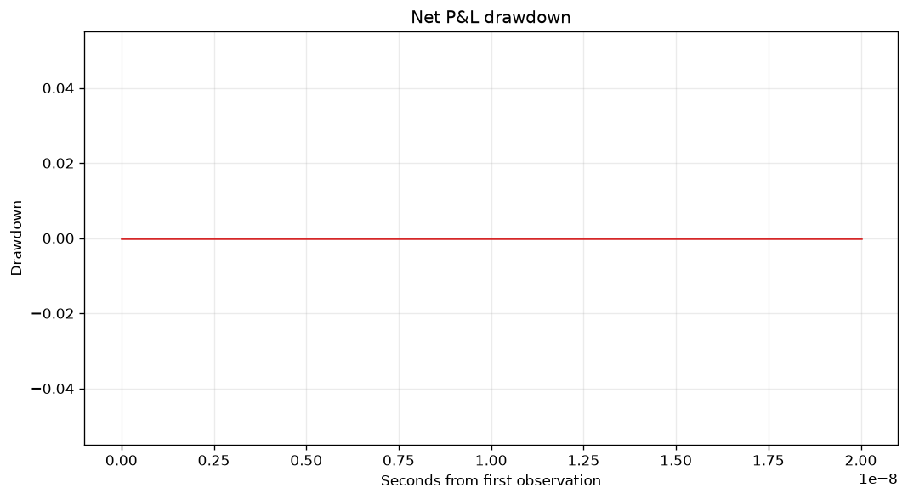
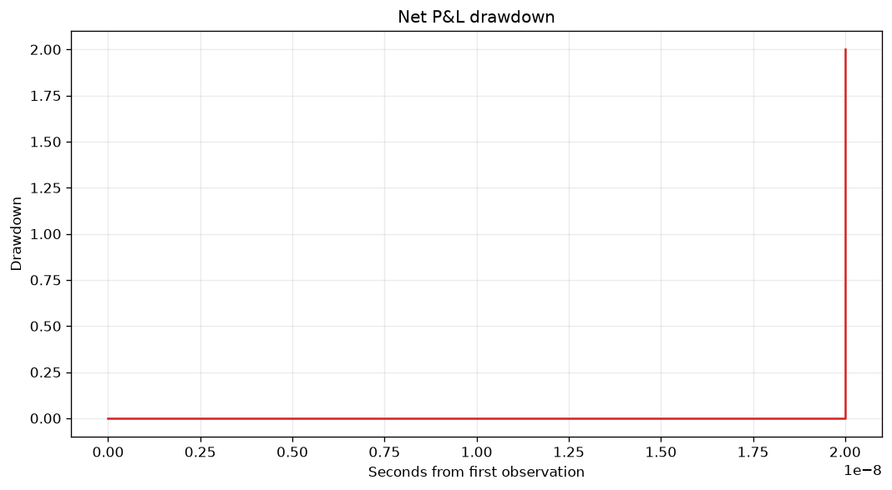

# Audit order in research reports — November 7, 2026

A reachable synthetic replay produced a drawdown of **2**, including a risk
halt, while the old report plotted **0**. The same report allocated **3** units
of PnL across each regime family even though terminal minus initial PnL was
**1**. Stable timestamp ordering fixes both displays. Keeping integer timestamps
until origin subtraction also preserves distinct epoch nanoseconds in the
drawdown plot. Execution and risk decisions are unchanged.

This is a reporting correctness result. The two prescribed, previously inspected
Nov5 cohorts showed **no changed curve points, regime allocations or PNG bytes**.
Their prior results are not revised by this study. No market-making advantage,
execution calibration or performance improvement was tested.

## Frozen design and provenance

The source comparator is main
`1ce45d29081b1a16699cd1e31a4fb3b088ca0a2f`. The initial contract was committed
as `31585e4c4b144348feb18396c46e855adbf2fb15`. A static review identified
premature epoch timestamp conversion and the parallel regime sort; amendment
`7cb3ff54befc40efdcf959e86b7391a3b045628c` included them **before any numerical
test, engine replay, plot or retained-outcome inspection**. The original contract
remains in Git history. Independent design review approved this bounded change.

The [contract](evidence/same-time-reporting-20261107/contract.json),
[fixed inputs](evidence/same-time-reporting-20261107/fixtures.json) and
[design review](evidence/same-time-reporting-20261107/design-review.json)
predefine hypotheses, scalar oracles, controls, equivalence criteria and stopping
rules. Contract SHA256 is
`26b51977ca815629bb386333e824cd956384c1d0f15e06025f61ce995dca8685`;
fixtures SHA256 is
`01f3229ca7d5ddfeec646cbaaead2f5088360556d8c861e51a5107586acbdefc`.

The budget was one report-only candidate and at most one independently reviewed
correctness repair. The first candidate passed; **no repair or retuning was
used**. Independent tests were frozen at `817b2c5`, then the observer/oracle and
runner at `be547be`, before their baseline execution. Candidate source was
committed as `ae12338686ae6553b0f1306691705653bb375c96`. Later commits contain
documentation, preserved evidence and CI only. Its `report.py` SHA256 is
`53f7b22ea40fe26996b86753af084fdf6126d89e3758a4002298ea2a21fd0ba4`.

There were no parameter, queue, latency or timing searches. Secondary attribution
sensitivity and effect magnitude on retained cohorts were descriptive questions,
not publication gates. The stopped Nov2 valuation-reuse and Nov4 lightweight
replay candidates remain closed and were not rerun.

## Primary result

Both old functions sorted `(timestamp, PnL)` tuples lexicographically. A lower
PnL at the same timestamp moved before a preceding high, hiding its drawdown and
changing the order of PnL increments. `_numeric_pairs` additionally converted
timestamps to float before sorting. This merged distinct epoch nanoseconds.

| Fixed comparison | Main | Candidate / independent oracle |
| --- | --- | --- |
| PnL `0,2,1,2` at times `0,10,10,20` | drawdown `0,0,0,0` | `0,0,1,0` |
| PnL `0,2,1,2` at epoch + `0,1,2,3` ns | all relative x coordinates `0` | `0,1e-9,2e-9,3e-9` seconds |
| Fixed regime vector, A at 10 and B at 20 | A=2, B=0 | A=1, B=1 |
| Full replay, last same-time PnL `3,1` | plotted maximum drawdown 0 | 2 |
| Full replay, each regime family's total | 3 | 1, matching terminal minus initial PnL |

Rising ties, distinct ordinary times, flat duplicate values and the default
numeric filtering/conversion behavior were controls. The initial frozen test
execution had **3 failures and 4 passes**, with no errors or skips. The first
candidate passed all seven cases. These were diagnostic cases, not an arbitrary
test-count target.

The full replay is strict, uncrossed and physically reachable within this
simulator. One unit ahead and one own unit are consumed by a two-unit trade;
two units added behind do not prevent the one-unit maker fill at 99. Held
inventory is one. At timestamp 20 an ask cancellation exposes a higher midpoint,
then a later same-time add restores it. Ordered PnL rows are
`0,0,0,1,1,3,1`, at times `0,0,5,10,10,20,20`.
The risk manager observes the drop of 2 against a limit of 1.5 and emits
`MAX_DRAWDOWN` at 20. The old plot still showed seven zeroes. The repaired plot
ends at 2, matching every point of the independent scalar high-water oracle.





The production patch is restricted to `report.py`: timestamp-key stable sorts in
drawdown and PnL-regime attribution, and a default-off private integer-preservation
option used only by drawdown. Integer origin subtraction precedes conversion to
seconds. Existing finite filtering, other numeric consumers and market-regime
as-of label selection are preserved. Noninteger legacy timestamp representations
retain their existing fallback; lost precision in previously stored floats
cannot be recovered. This does not establish runtime or delivery nanosecond
precision. Initial-peak/zero-anchor conventions are unchanged.

## Independent execution equivalence

The frozen provider runs three full backtests (`maker_prefix`,
`maker_late_tail`, `drawdown_order`) and one Exchange/Scheduler primitive control
(`taker_phase_control`) per source. The last is explicitly not a full backtest.
A strict dictionary book oracle, hand-derived queue budget and delegating
observers record scheduler keys, pre/post BBOs, returned fills and risk
observations. The observers copy values and call the original handlers.

All eight Parquet files in every full case are byte-identical between main and
candidate: orders, fills, inventory, PnL, market, markouts, risk events and quotes.
All four canonical execution effects, including config/event fingerprints,
nonclock metrics, diagnostics, scheduler/Exchange records and risk decisions,
are equal. Only the predefined reporting outputs change. Independent artifact
review rehashed and decoded all **48** actual Parquet files, checked the raw
records against the physical oracle and checked every captured plot point and
regime bar. It also verified 20 actual PNGs and closed figures. Source review and
artifact review both returned GO without reruns or repairs.

## Secondary result: an attribution convention, not a backfill

Appending a later same-timestamp ask cancellation leaves the maker fill and its
first fill-count PnL snapshot identical. The causing trade's pre/post midpoint
is 100 in both tapes. The existing `_fill_midpoints` as-of reference nevertheless
changes from 100 to 102, so spread capture and realized spread in ticks change
from **1 to 3**. This demonstrates the current **end-of-timestamp** convention.
Later inventory marking legitimately changes terminal/booked PnL from 1 to 3;
the experiment does not show a booked-PnL error.

The complementary taker control submits a command after all historical events
at that timestamp. Its actual entry and post-fill midpoint are 102, matching the
existing reference. A strictly earlier timestamp lookup would give 100 and
would not describe that command's entry market. Thus a blanket strict-before
replacement is not justified. No attribution code, schema or causal fields were
added. Generic historical fill rows do not identify causal midpoint references.
A complete PnL join can only conditionally recover a post-cause mark under
MIDPOINT marking, a two-sided book and the appropriate fill-count snapshot;
that is not a generic historical repair. Regime labels likewise retain their
existing as-of convention rather than claiming causal identification.

## Retained cohorts: negative finding

This was read-only reanalysis of the exact Nov5 artifacts named and hashed in
the frozen contract and manifest. They were already exposed, not fresh holdouts.
No new 20k replay or performance timing was run.

| Retained cohort | PnL rows | Maximum drawdown, both sources | Changed x/y points | Regime changes |
| --- | ---: | ---: | ---: | --- |
| CI300 | 315 | 0.09899999999999998 | 0 / 0 | none |
| Benchmark20k | 20,772 | 274.4416 | 0 / 0 | none |

Every original input file matches the frozen Nov5 manifest: 12 files per cohort,
24 total. Both sources match the complete oracle curves, not just their maxima;
the corresponding PNG bytes are identical too. The [retained summary](evidence/same-time-reporting-20261107/retained-summary.json)
records full-curve digests, source identities, original file hashes and raw paths.
The complete arrays and worker logs remain in the saved cloud workspace.
No broad claim of historical report distortion is supported by these cohorts.

## Reproduction, trial accounting and checks

Run from the repository with Python 3.12 and its declared development dependencies:

```sh
python tools/reproduce_same_time_reporting.py --stage regression --candidate <full-git-sha> --output experiments/verification-regression
python tools/reproduce_same_time_reporting.py --stage study --candidate <full-git-sha> --output experiments/verification-study
```

The runner creates Git archives for pinned main and the specified full candidate
SHA, verifies imported source paths/hashes and frozen inputs, retains logs and
partial failures, refuses output overwrites and caps each worker at 120 seconds.
The original local executions observed three main failures/four passes and seven
candidate passes. The runner enforces the same nonempty collected corpus, at
least one main failure, no errors/skips and an all-pass candidate; it does not
enforce the exact three failing node IDs. CI logs/results must therefore also
be inspected for the observed 3/4-to-7 pattern. The study verifies all four cases
per source. The runner records Python and
dependency identities. Different dependency versions may change PNG bytes;
the numerical artists and scalar oracles are the decision criteria.

After the initial draft publication, a CI-only visibility follow-up prints the
already retained regression worker logs in the job log. This permits verification
of the exact baseline failures/counts through supported log reads without an
artifact ZIP transfer. It also prints the study's source identities, completion
status and case ledger. It changes no source, test, fixture, runner or criterion;
the earlier head's CI is not used as evidence for the final head.

Original local sequence, with no discarded attempts:

1. Frozen baseline unit execution: three expected failures, four passes.
2. Four main cases, once each, before implementation: three full replays and one
   primitive control.
3. One candidate, initial unit execution: seven passes, no repair.
4. Four candidate cases, once each, reusing and rehashing the saved main results.
5. Four retained plotting workers: two sources by two cohorts, **no engine**.
6. Full ordinary suite: **257 passes, 90.68% branch-aware coverage**; strict mypy
   on 37 source files, Ruff lint and format all passed.

The archived `regression` stage was not additionally run locally: the original
before/after unit runs, ordinary suite and prescribed CI replication serve that
verification. CI explicitly checks out the PR head (or push SHA), records it,
runs ordinary checks/smoke plus archived main/candidate regression and the fixed
four-case study, and uploads numerical/source artifacts for 14 days. The retained
stage is **local-only and not run in CI**, because its exact original artifacts
live in the retained cloud workspace. A successful workflow badge alone does
not prove historical ZIP retention; artifact metadata/logs and any unperformed
ZIP-byte audit must be reported separately.

Committed [local evidence](evidence/same-time-reporting-20261107/local/)
preserves controlled raw records, actual replay tables/PNGs, logs and JUnit.
The [workspace manifest](evidence/same-time-reporting-20261107/workspace-manifest.json)
identifies the complete original raw files at
`/workspace/lob-market-maker-ordering-fix/experiments/same-time-reporting-20261107/`.
The original local candidate SHA above identifies the measured implementation;
the PR description records the final published SHA and verified CI run separately.

## Decision and remaining prerequisites

Publish the minimal report fix as a standalone draft against main. Keep PR1–5
independent and unchanged. Use ordered audit rows when interpreting drawdown and
PnL increments, and label current fill attribution by its end-of-timestamp
convention. Do not infer a historical economic correction from these witnesses.

Read-only input review found no new usable real L2/trade tape or execution
calibration in this matching LOB executor. Existing adapter fixtures explicitly
describe fictional data; configured experiment inputs are synthetic/SIMULATED.
No data was acquired or imported from another executor. A market-making study
still requires legally usable multi-session L2 plus trade data, sequence/gap and
reset information, source/collector clocks and provenance, dated tick/lot/fee
rules, and latency/priority/order-ack-cancel-fill calibration or defensible bounds.
Top-of-book quote files alone do not identify passive fills. No economic-data
blocker, PR3 accounting overhead/output-growth limitation or prior recovery
limitation was resolved. This study claims bounded reporting mechanics only.
